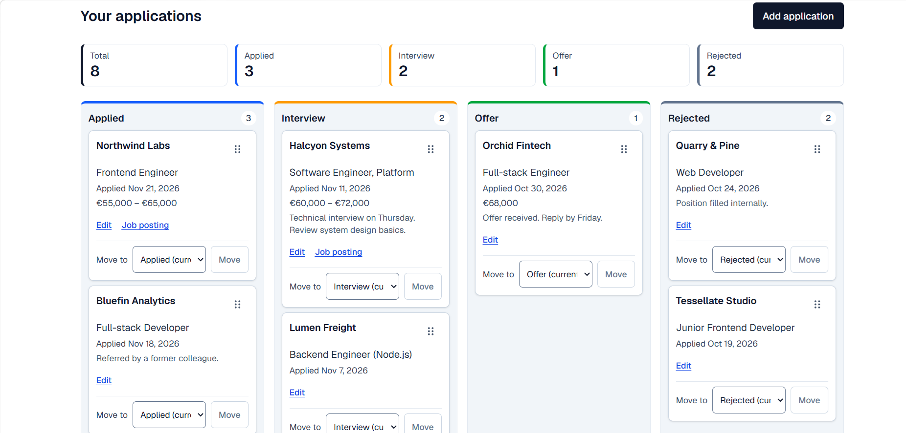

# Job Application Tracker

[](https://github.com/eneoxkeskin/job-tracker/actions/workflows/ci.yml)

Track your job applications on a Kanban board: sign in with GitHub, add applications, and move
them from **Applied** to **Interview**, **Offer** or **Rejected** with drag and drop, the
keyboard, or a simple "Move to" menu.

**Live demo:** https://job-tracker-flame-seven.vercel.app. Click **Try demo** to get a private
board with sample data, no account needed, or sign in with GitHub.



## Features

- **Try demo without an account.** Each visitor gets their own temporary demo user with a
  realistic board. It is private, limited to one hour, and deleted when they exit.
- **GitHub sign-in** (Auth.js, database sessions that can be revoked on the server).
- **Create, edit and delete applications**: company, job title, posting URL, notes, applied
  date, and an optional yearly salary range with currency.
- **Kanban board with four stages**: drag and drop between and within columns. The order is
  saved per column.
  - **Keyboard:** focus a card's handle, press Space, use the arrow keys, then press Space again.
  - **"Move to" menu** on every card. It works on touch devices, with screen readers, and even
    without JavaScript.
- **Optimistic updates.** Moves show instantly. If the server rejects a move, the card snaps
  back and an error message appears.
- **Stage summary**: total and per-stage counts that update live while you drag.
- **Follow-ups**: an optional follow-up date per application. Cards show "Follow up on …",
  "Follow up today", or an overdue warning with an icon and text (never color alone).
- **"No response for N days"** on Applied and Interview cards after 14 days without a change.
- **Stage history**: every stage change is recorded and listed on the edit page.
- **Insights** derived from that history: the Applied → Interview rate and the average time to
  a first response, each with its sample size, and an explanatory empty state until there are
  at least 3 data points.
- **Every state is handled**: empty board, empty columns, loading skeleton, error boundaries
  with retry, inline form errors that keep what you typed, and pending buttons.
- **Accessible and responsive**: labelled controls, visible focus, WCAG AA contrast, screen
  reader announcements for drag and drop, reduced-motion support, and touch targets of at
  least 44 px. Columns scroll horizontally on phones.

## Tech stack

| Area          | Choice                                                                                  |
| ------------- | --------------------------------------------------------------------------------------- |
| Framework     | Next.js 16 (App Router, Server Components, Server Actions), React 19                    |
| Language      | TypeScript (`strict`, `noUncheckedIndexedAccess`)                                       |
| Styling       | Tailwind CSS v4                                                                         |
| Database      | PostgreSQL on Neon (Frankfurt), pooled connection at runtime and direct for migrations  |
| ORM           | Prisma 7 with the `pg` driver adapter                                                   |
| Auth          | Auth.js v5 (`next-auth@5.0.0-beta.32`), GitHub provider, Prisma adapter                 |
| Validation    | zod 4, on the server for every input                                                    |
| Drag and drop | dnd-kit (core + sortable)                                                               |
| Testing       | Vitest (unit), axe-core + jsdom (accessibility), Vitest against a real DB (integration) |
| Hosting       | Vercel, functions in `fra1` (Frankfurt), the same region as the database                |

## Architecture

```
src/
├─ app/                        # routing only: pages, loading/error/not-found, 2 route handlers
├─ auth.ts, auth.config.ts     # Auth.js setup (GitHub provider, database sessions)
├─ lib/
│  ├─ db.ts                    # Prisma client (server-only, pooled DATABASE_URL)
│  ├─ session.ts               # requireUserId(): the single source of the user id
│  ├─ auth-adapter.ts          # Prisma adapter + demo guards (no session extension, no linking)
│  └─ auth-cookie.ts           # Auth.js session cookie naming, for the demo session
├─ features/demo/              # Try demo: create, rate limit, quota, cleanup, sample data
└─ features/applications/
   ├─ schema.ts                # zod schemas (server-authoritative)
   ├─ ranking.ts               # pure ordering logic shared by server and optimistic UI
   ├─ history.ts               # follow-ups, waiting time, event-based insights (pure)
   ├─ stats.ts, stages.ts, format.ts, dnd-announcements.ts
   ├─ queries.ts               # server-only reads, always scoped to the signed-in user
   ├─ actions.ts               # Server Actions: create / update / delete / move
   └─ components/              # board (client, dnd-kit), card, form, dialogs, summary
```

Key decisions (the full rationale is in [PLAN.md](PLAN.md)):

- **Authorization lives in the data layer, not in middleware.**
  - Every query and Server Action resolves the user with `requireUserId()` and filters with
    `where: { id, userId }`.
  - Another user's record is indistinguishable from a missing one (404, never 403).
  - Server Actions are treated as public endpoints. Ids passed with `.bind()` are validated,
    because they reach the browser unencrypted.
- **Ordering uses an integer `rank` per column, renumbered on each move** in one transaction.
  - The client sends `{ id, toStage, toIndex }`, never ranks.
  - The same pure functions compute the optimistic order and the saved order.
  - Fractional indexing was considered. It wasn't chosen because of Postgres collation
    pitfalls and its extra complexity at this scale.
- **Neon connections**:
  - The app uses the pooled URL, which suits serverless.
  - Prisma's CLI uses the direct URL, because migrations need a stable session for advisory
    locks.
- **The demo signs visitors in without Auth.js providers.** A Server Action creates a demo user
  and a normal Auth.js `Session` row, then sets Auth.js' own session cookie. Auth.js'
  Credentials provider only works with JWT sessions, and this app uses database sessions.
  - Two Auth.js behaviors were found in its source and guarded against: it extends every
    session to 30 days on read, and it links a new OAuth account to whoever is signed in.
    Integration tests prove both guards (and fail when the guards are removed).
- **No UI kit.** The app uses native elements: `<dialog>` for the delete confirmation and
  plain `<form>`s that work without JavaScript.

## Security

- All inputs are validated with zod on the server. Posting URLs must be `http(s)` with a real
  domain, so a stored `javascript:` link can't become XSS.
- The `userId` always comes from the session. A `userId` injected into a form is ignored, and
  tests prove it.
- Errors are logged on the server. Clients get generic messages, never Prisma or internal
  details.
- Secrets live only in environment variables. `.env` is gitignored and
  [`.env.example`](.env.example) documents the variables.
- External links use `rel="noopener noreferrer"`.
- **Demo hardening:**
  - a hard one-hour session (`HttpOnly`, `SameSite=Lax`, `Secure` on https) with a 256-bit
    token;
  - rate limits of 5 demos per IP per hour and 100 per hour overall, race-free under a
    Postgres advisory lock; IPs are stored only as an HMAC;
  - a quota of 30 applications per demo (1,000 for GitHub users);
  - a demo user can never get a GitHub account linked to it;
  - a daily cleanup cron, protected by `CRON_SECRET` (constant-time check, fails closed).

## Testing

```powershell
npm run check              # ESLint + TypeScript + unit and accessibility tests
npm run test:integration   # Server Actions against a real database (Neon dev branch)
```

**CI** ([`.github/workflows/ci.yml`](.github/workflows/ci.yml)) runs on every push and pull
request with Node 24: lint, typecheck, unit tests, migrations plus integration tests against a
throwaway Postgres service container, and a production build.

- **Unit tests** cover validation (URL protocols, form coercion, salary rules, dates), ordering
  and index clamping, stats, follow-up and waiting-time rules, insights, formatting, the demo
  rules and seed, and the screen-reader texts.
- **Accessibility tests** render the real components and scan them with axe-core (WCAG 2.2
  A/AA). Color contrast is checked separately against the palette (see PLAN.md).
- **Integration tests** run against a real database.
  - **Coverage:**
    - one user can't read, update, move or delete another user's application;
    - injected ids are ignored;
    - clearing a field stores `NULL`;
    - moves renumber columns correctly;
    - stage history: creation and stage changes are recorded, reorders aren't, a failed
      cross-user move records nothing, the history cap, and metrics that only count the
      signed-in user's applications;
    - the demo: sign-in cookie, Auth.js accepting the session on http and https without
      extending it, rate limits (including a concurrent burst), quotas, exit, cleanup, the
      cron endpoint, and isolation between demo and real users in both directions.
  - **Checked by mutation:** removing the `userId` filter from the delete query makes the
    cross-user test fail.

## Running locally (Windows / PowerShell)

Prerequisites:

- **Node.js 24+.**
- **A Neon project** with a `dev` branch.
- **A GitHub OAuth App** with the callback `http://localhost:3000/api/auth/callback/github`.

```powershell
git clone https://github.com/eneoxkeskin/job-tracker.git
cd job-tracker
npm install
Copy-Item .env.example .env   # then fill in the values (see below)
npx prisma migrate dev        # applies migrations to the database in DIRECT_URL
npm run dev                   # http://localhost:3000
```

| Variable                                | Purpose                                                                                         |
| --------------------------------------- | ----------------------------------------------------------------------------------------------- |
| `DATABASE_URL`                          | Neon **pooled** connection string (host contains `-pooler`), used by the app                    |
| `DIRECT_URL`                            | Neon **direct** connection string, used only by the Prisma CLI                                  |
| `AUTH_SECRET`                           | Random secret: `node -e "console.log(require('crypto').randomBytes(32).toString('base64url'))"` |
| `AUTH_GITHUB_ID` / `AUTH_GITHUB_SECRET` | GitHub OAuth App credentials                                                                    |
| `CRON_SECRET`                           | Protects the demo cleanup cron (16+ random characters, generated like `AUTH_SECRET`)            |

Use `sslmode=verify-full` in both connection strings.

| Script                                     | What it does                                             |
| ------------------------------------------ | -------------------------------------------------------- |
| `npm run dev`                              | Development server                                       |
| `npm run build` / `npm start`              | Production build / server                                |
| `npm run check`                            | Lint, typecheck and unit tests (run before every commit) |
| `npm run test:integration`                 | DB-backed tests (never point them at production)         |
| `npm run format`                           | Prettier                                                 |
| `npm run db:migrate` / `npm run db:studio` | Prisma migrate / Prisma Studio                           |

## Deployment

The app is deployed on Vercel from `main`, with functions pinned to `fra1` in
[`vercel.json`](vercel.json).

- **Environment variables** (`DATABASE_URL`, `AUTH_SECRET`, `AUTH_GITHUB_ID`,
  `AUTH_GITHUB_SECRET`, `CRON_SECRET`) are scoped to **Production** only, so preview deployments can't touch
  the production database.
- **A daily Vercel Cron job** (`vercel.json`) calls `/api/cron/cleanup-demo` with
  `Authorization: Bearer $CRON_SECRET` and deletes expired demo users and sessions.
- **Production uses its own GitHub OAuth App**, because an OAuth App has a single callback URL.
- **Migrations run explicitly** with `npx prisma migrate deploy` against the production
  branch's direct URL. They're not run during the build, which keeps schema changes deliberate.
- **The build fails if `DATABASE_URL` is missing.** This is intentional, so a misconfigured
  environment never produces a deployment that looks healthy but doesn't work.

## Roadmap

- Editing in a modal through intercepting routes, keeping the full page as a fallback.
- Search, filtering and sorting by date.
- Dark mode.
- Not storing the unused GitHub OAuth access token.
- A database-level `CHECK (salary_min <= salary_max)` constraint.
- Playwright end-to-end smoke tests.
